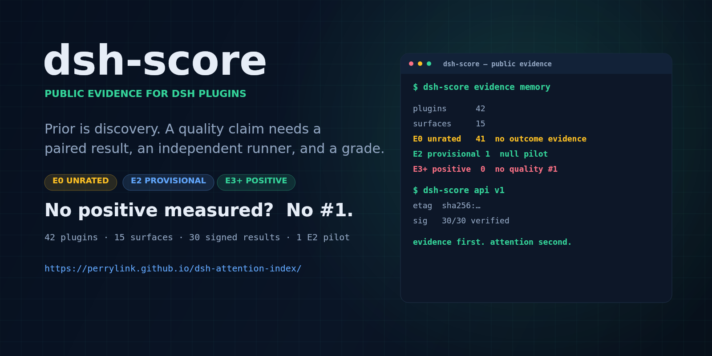
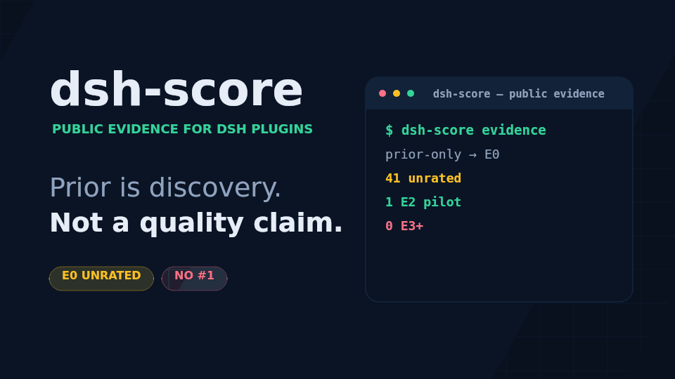
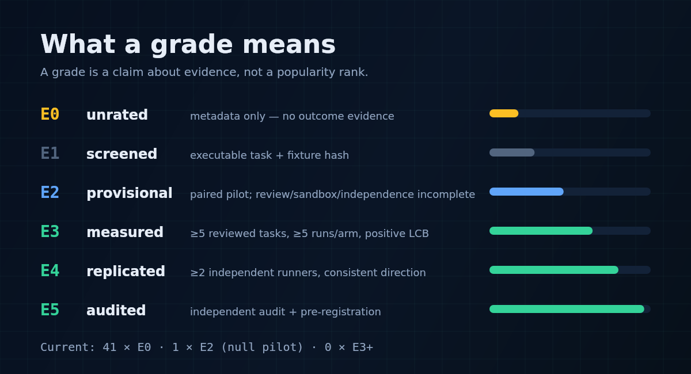

<div align="center">

# 🏆 dsh-score

**Public evidence for DeepSeek Harness plugins — and an explicit rule for who gets community attention.**

*Prior is discovery. A quality claim needs a paired result, a grade, and an independent path.*

[](https://github.com/PerryLink/dsh-attention-index/actions)
[](https://perrylink.github.io/dsh-attention-index/)
[](https://perrylink.github.io/dsh-attention-index/api/v1/index.json)
[](https://gitcode.com/PerryLink/dsh-attention-index)
[](LICENSE)
[](https://github.com/topics/dsh-plugin)

[English](README.md) · [简体中文](README-zh.md)

```sh
# public evidence (this repo)
open https://perrylink.github.io/dsh-attention-index/

# in-app consumer
dsh plugin --profile web add dsh-community-bench
```

</div>

---





*The same rule, animated.*

## Why this exists

Plugin discovery is not a popularity contest, and a download count is not a
task-outcome claim. `dsh-score` separates four things that used to be mixed:

1. **Discovery** — is this plugin maintained and visible?
2. **Evidence** — was it run with and without on the same task?
3. **Grade** — how strong is that evidence (E0–E5)?
4. **Attention** — only a positive, adequately powered result gets a quality slot.

At v0.1 the answer is deliberately uncomfortable: **there is no quality #1**.

## Current state

| Metric | Value |
|---|---:|
| Plugins | **42** |
| Capability surfaces | **15** |
| Tasks | **39** (24 executable pilot + 15 draft) |
| Signed results | **30** |
| E0 / unrated | **41** |
| E2 / provisional | **1** (a null pilot) |
| E3+ / positive | **0** |
| Quality #1 | **none** |
| Public contributions | **0** |

The first pilot is `dsh-memento@0.5.27` on five memory tasks × three runs/arm.
Both arms passed every task: it is a **null result**, capped at **E2** because
the task pack is unreviewed, the runner is operator-owned, and the sandbox is
network-isolated but not seccomp-hardened. `rank` is `null`; `top3` is empty.

## What a grade means



| Grade | Meaning | Quality slot? |
|---|---|---|
| **E0** | unrated — metadata only, no outcome evidence | No |
| **E1** | screened — executable task + fixture hash | No |
| **E2** | provisional — paired pilot; review/sandbox/independence incomplete | No |
| **E3** | measured — ≥5 reviewed tasks, ≥5 runs/arm, positive LCB | Yes |
| **E4** | replicated — ≥2 independent runners, consistent direction | Yes |
| **E5** | audited — independent audit + pre-registration | Yes |

**Hard gates:** an unreviewed pack or a partial sandbox caps at **E2**; E5
requires an independent audit in [`data/audits/index.json`](data/audits/index.json).
No prior-only row can receive a quality rank. No one can buy a slot.

Full model: [docs/SOE-GOE.md](docs/SOE-GOE.md) · [SCORING.md](SCORING.md).

## What is public

| Artifact | What it is |
|---|---|
| [Evidence site](https://perrylink.github.io/dsh-attention-index/) | Human view; E0/unrated is visible, not hidden |
| [`data/registry.json`](data/registry.json) | Single machine-readable registry |
| [`api/v1/registry.json`](api/v1/registry.json) | Versioned snapshot + `etag` |
| [`integrations/market/signals.json`](integrations/market/signals.json) | Decoration sidecar for markets; not a ranking input |
| [`badges/index.json`](badges/index.json) | Per-plugin badge; unrated is explicit |
| [`integrations/dsh-recommend/bench-feed.json`](integrations/dsh-recommend/bench-feed.json) | Sidecar for `dsh-recommend` |
| [`data/results/`](data/results) | 30 signed arm results (15 pairs; hashes, no session text) |

```sh
curl https://perrylink.github.io/dsh-attention-index/api/v1/registry.json
```

## Quick start

```sh
# 1. Recompute the registry deterministically
node scripts/aggregate.mjs --today 2026-10-18

# 2. Contract checks
node scripts/check-invariants.mjs
node scripts/conformance.mjs
node --test test/*.test.mjs

# 3. Preview the site
python3 -m http.server 8765 --directory site
```

## The pipeline

```
task pack (pilot, unreviewed)
  → paired with/without runs
  → signed result + environment manifest + fixture hash
  → strict ingest (signature, fixture, duplicate)
  → Newcombe interval + SOE/GOE grade
  → E0/E1 no rank · E2 provisional · E3+ positive quality slot
```

- [P1 measured-evidence runbook](docs/P1-RUNBOOK.md)
- [Sandbox requirements](docs/SANDBOX.md)
- [P2 integration contract](docs/P2-INTEGRATION.md)
- [P3 audit checklist](docs/AUDIT-CHECKLIST.md)
- [P0–P3 status](docs/P0-P3-PLAN.md)

## Not done yet

- A **seccomp/cgroup-hardened** sandbox; current `bwrap-net` has FS/PID/network isolation and a DeepSeek-only egress proxy, but no seccomp.
- Task review and an **independent runner** for E3+.
- FDR/bootstrap are implemented but not wired; holdouts, version binding and token accounting remain.
- Signed snapshot history and a third-party market pilot.
- E5 (independent audit) — a self-review is published, but it is not E5.
- Repository rename to `dsh-score-index`; URLs are intentionally stable.

No fabricated results. No prior-only #1. No paid rank.

## DSH plugin family

| Project | Role |
|---|---|
| **[dsh-score](https://github.com/PerryLink/dsh-score)** | Local, on-demand prior inspector (five dimensions) |
| **dsh-score index** (this repo) | Public, version-bound evidence layer |
| **[dsh-community-bench](https://github.com/PerryLink/dsh-community-bench)** | In-app consumer: reads the public registry; no local scoring |
| **[dsh-kit](https://github.com/PerryLink/dsh-kit)** | One-command starter pack for the family |
| **[PerryLink](https://github.com/PerryLink)** | 40+ Apache-2.0 DSH plugins |

## ⭐ 如果它帮到了你

这个项目是 [DSH 插件家族](https://github.com/PerryLink)的一员（40+ 个，全部 Apache-2.0）。如果你在用，**给个 star** —— 它不会解锁任何功能，但会让下一个人在搜索里更容易找到它。

*English:* part of a 40+ plugin family for DeepSeek Harness. If it is useful, **a star helps the next person find it** — nothing is gated behind it.

## License

Apache-2.0. See [LICENSE](LICENSE).
